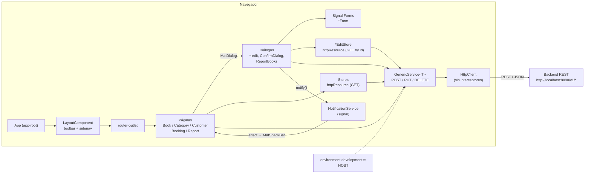
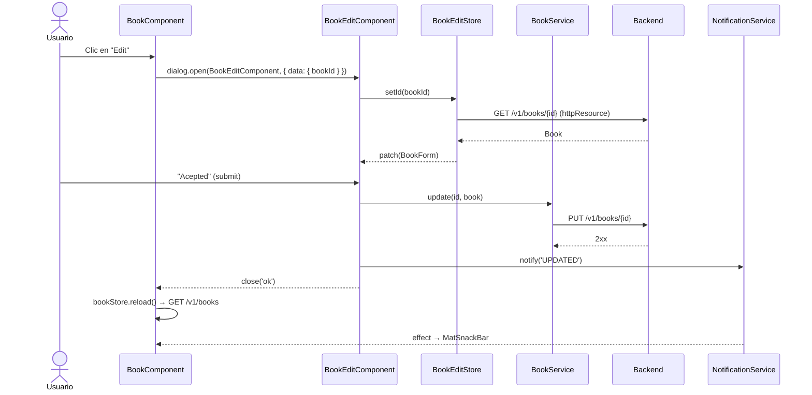

# library-ui

Frontend Angular para la gestión de una **biblioteca**: administración de libros, categorías y clientes, registro de reservas (*bookings*) y un reporte de reservas. La aplicación consume una API REST externa (no incluida en este repositorio) expuesta por defecto en `http://localhost:8080`.

> Este documento describe el **estado real** del código. Las funcionalidades parciales o pendientes se indican explícitamente en la sección [Observaciones y pendientes](#13-observaciones-y-pendientes).

---

## Tabla de contenidos

1. [Información general](#1-información-general)
2. [Stack tecnológico](#2-stack-tecnológico)
3. [Arquitectura y estructura del proyecto](#3-arquitectura-y-estructura-del-proyecto)
4. [Requisitos previos](#4-requisitos-previos)
5. [Instalación del proyecto](#5-instalación-del-proyecto)
6. [Configuración de ambientes y variables](#6-configuración-de-ambientes-y-variables)
7. [Ejecución del proyecto](#7-ejecución-del-proyecto)
8. [Integración con el backend](#8-integración-con-el-backend)
9. [Navegación y funcionalidades](#9-navegación-y-funcionalidades)
10. [Pruebas y calidad de código](#10-pruebas-y-calidad-de-código)
11. [Compilación y despliegue](#11-compilación-y-despliegue)
12. [Consideraciones para desarrolladores](#12-consideraciones-para-desarrolladores)
13. [Observaciones y pendientes](#13-observaciones-y-pendientes)

---

## 1. Información general

| Campo | Valor |
| --- | --- |
| Nombre del paquete | `library-ui` (`package.json`) |
| Versión | `0.0.0` |
| Tipo de proyecto | Aplicación Angular (`projectType: application`) |
| Prefijo de selectores | `app` |
| Título HTML | `LibraryUi` (`src/index.html`) |

**Objetivo.** Ofrecer una interfaz web de administración para el backend de biblioteca, que permita mantener los catálogos (libros, categorías, clientes), registrar reservas de libros y consultarlas.

**Funcionalidades implementadas:**

- **Libros:** listado con filtro, ordenamiento y paginación; alta, edición y eliminación (con confirmación) mediante diálogos.
- **Categorías:** listado, alta, edición y eliminación.
- **Clientes:** listado, alta, edición y eliminación.
- **Registro de reserva:** formulario (paso 1 de un *stepper*) para seleccionar un cliente, una fecha y uno o varios libros, y enviar la reserva.
- **Reporte de reservas:** listado de reservas con filtro y paginación, y un diálogo con los títulos de los libros de cada reserva.
- **Notificaciones:** mensajes *snackbar* (`CREATED`, `UPDATED`, `DELETED`) después de cada operación.

---

## 2. Stack tecnológico

Las versiones declaradas provienen de `package.json`; las versiones resueltas, de `package-lock.json` / `node_modules`.

| Tecnología | Descripción | Versión declarada | Versión resuelta |
| --- | --- | --- | --- |
| Angular (`@angular/core`, `common`, `forms`, `router`, `platform-browser`, `compiler`) | Framework frontend | `^22.2.0` | 22.2.2 |
| Angular CLI (`@angular/cli`) | Herramienta de desarrollo | `^22.2.2` | 22.2.2 |
| `@angular/build` | Builders `application`, `dev-server` y `unit-test` (esbuild/Vite) | `^22.2.2` | 22.2.2 |
| Angular Material + CDK | Componentes de UI (Material 3) | `^22.2.2` | 22.2.2 |
| Angular Signal Forms (`@angular/forms/signals`) | Formularios basados en *signals* | incluido en `@angular/forms` | 22.2.2 |
| TypeScript | Lenguaje | `~6.0.2` | 6.0.3 |
| RxJS | Programación reactiva | `~7.8.0` | 7.8.2 |
| tslib | Helpers de TypeScript (`importHelpers: true`) | `^2.3.0` | 2.8.1 |
| Vitest | Framework de pruebas unitarias | `^5.0.0` | 5.0.3 |
| jsdom | DOM simulado para las pruebas | `^30.0.0` | 30.1.2 |
| Prettier | Formateo de código | `^3.8.1` | 3.9.9 |
| Node.js | Entorno de ejecución | `^22.22.3 \|\| ^24.15.0 \|\| >=26.0.0` (*engines* de Angular 22) | — |
| npm | Gestor de paquetes | `packageManager: npm@12.2.0` | — |

Recursos externos cargados desde `src/index.html`: fuente **Roboto** y los íconos **Material Symbols Outlined** desde Google Fonts (se necesita conexión a internet para verlos).

---

## 3. Arquitectura y estructura del proyecto

### 3.1 Enfoque arquitectónico

- **Standalone components**: no hay `NgModule`. La app arranca con `bootstrapApplication(App, appConfig)` (`src/main.ts`).
- **Providers globales** (`src/app/app.config.ts`): `provideBrowserGlobalErrorListeners()`, `provideRouter(routes)` y `provideHttpClient()` (sin interceptores).
- **Estado basado en *signals***: cada pantalla usa un *store* que expone `httpResource` (lectura reactiva) como *signals* (`$books`, `$loading`, `$error`).
- **Escrituras con `HttpClient`**: las operaciones de creación, actualización y eliminación se hacen con un servicio CRUD genérico (`GenericService<T>`) que devuelve `Observable`.
- **Formularios con Signal Forms**: clases `*Form` que encapsulan un `signal` del modelo, el `form()` y las validaciones.
- **Servicios con `@Service()`**: decorador de Angular 22. Los servicios marcados con `@Service()` sin opciones se resuelven globalmente; los marcados con `@Service({ autoProvided: false })` (stores y forms) **deben** declararse en `providers` del componente que los usa, por lo que su ciclo de vida queda ligado a ese componente.

### 3.2 Árbol de directorios

```text
library-ui/
├── public/                     # Assets estáticos copiados tal cual al build (favicon.ico, logo.png)
├── src/
│   ├── index.html              # HTML raíz, <base href="/">, fuentes de Google
│   ├── main.ts                 # Bootstrap de la aplicación
│   ├── material-theme.scss     # Tema Material 3 (azure/blue, Roboto, densidad 0, modo claro)
│   ├── styles.css              # Estilos globales (.cancel-button)
│   ├── environments/
│   │   ├── environment.ts              # Ambiente por defecto (production)
│   │   └── environment.development.ts  # Ambiente de desarrollo
│   └── app/
│       ├── app.ts / app.html / app.css # Componente raíz: renderiza <app-layout>
│       ├── app.config.ts               # Providers globales
│       ├── app.routes.ts               # Tabla de rutas
│       ├── components/                 # Pantallas (features)
│       │   ├── layout/                 # Toolbar + sidenav + <router-outlet>
│       │   ├── book/                   # Listado de libros
│       │   │   └── book-edit/          # Diálogo alta/edición de libro
│       │   ├── category/
│       │   │   └── category-edit/
│       │   ├── customer/
│       │   │   └── customer-edit/
│       │   ├── booking/                # Registro de reserva (stepper)
│       │   └── report/                 # Reporte de reservas
│       │       └── report-books/       # Diálogo con los libros de una reserva
│       ├── forms/                      # Signal Forms: BookForm, CategoryForm, CustomerForm, BookinWizardForm
│       ├── material/                   # CustomDateAdapter (parseo dd/MM/yyyy para el datepicker)
│       ├── model/                      # Clases de dominio: Book, Category, Customer, Booking, BookingResponse
│       ├── services/                   # GenericService<T> y servicios REST por recurso
│       ├── shared/
│       │   ├── components/confirm-dialog/  # Diálogo reutilizable de confirmación de borrado
│       │   └── services/notification.service.ts  # Bus de mensajes basado en signal
│       └── store/                      # Stores con httpResource (listados y detalle para edición)
├── .agents/                    # Documentación y skill para asistentes de IA (no forma parte del build)
├── angular.json                # Configuración del workspace y builders
├── package.json / package-lock.json
├── tsconfig.json / tsconfig.app.json / tsconfig.spec.json
├── .editorconfig / .prettierrc
└── .vscode/                    # Extensiones recomendadas, tareas y configuraciones de depuración
```

### 3.3 Responsabilidades por capa

| Capa | Ubicación | Responsabilidad |
| --- | --- | --- |
| Componentes de página | `components/<feature>/` | Tabla Material (`MatTableDataSource` con filtro, `MatSort` y `MatPaginator`), apertura de diálogos y refresco del store |
| Diálogos de edición | `components/<feature>/<feature>-edit/` | Reciben `{ <entidad>Id }` por `MAT_DIALOG_DATA`; si hay id, cargan la entidad (modo edición), si no, crean una nueva. Cierran con `'ok'` cuando la operación termina bien |
| Componentes compartidos | `shared/components/confirm-dialog/` | Devuelve `true`/`false` al cerrar; se usa antes de cada eliminación |
| Servicios REST | `services/` | `GenericService<T>`: `findAll`, `findById`, `save`, `update`, `delete`, y `resourceUrl` para los stores |
| Stores | `store/` | `*Store`: listado con `httpResource<T[]>` y `reload()`. `*EditStore`: detalle con `httpResource<T>` según un `$id` |
| Formularios | `forms/` | Modelo en un `signal`, validaciones, `patch()`, `value()` y `$isInvalid()` |
| Modelos | `model/` | Contratos de datos intercambiados con la API |
| Notificaciones | `shared/services/notification.service.ts` | `notify()` / `clear()`; los componentes de página leen `$message` en un `effect` y muestran un `MatSnackBar` |
| Adaptadores Material | `material/custom-adapter.ts` | `CustomDateAdapter` (extiende `NativeDateAdapter`), declarado en `BookingComponent` |

**Elementos no presentes en el proyecto:** guards, interceptores HTTP, pipes y directivas personalizadas, autenticación/autorización, *lazy loading* de rutas, NgRx u otra librería de estado externa.

### 3.4 Diagrama de arquitectura



### 3.5 Flujo típico (alta o edición de un registro)



---

## 4. Requisitos previos

| Herramienta | Versión | Observación |
| --- | --- | --- |
| Node.js | `^22.22.3`, `^24.15.0` o `>=26.0.0` | Rango exigido por `@angular/core` y `@angular/cli` 22.2.2 (`engines`) |
| npm | `12.2.0` (campo `packageManager` de `package.json`) | Si usas Corepack se aplicará esta versión. El CLI de Angular acepta `npm >= 8` |
| Angular CLI | 22.2.2 (dependencia local) | **No hace falta instalarlo globalmente**: los scripts `npm` usan el CLI local. Para llamarlo directamente, usa `npx ng ...` |
| Git | Cualquier versión reciente | Para clonar el repositorio |
| IDE | Visual Studio Code (recomendado) | `.vscode/extensions.json` recomienda la extensión **Angular Language Service** (`angular.ng-template`) |
| Navegador | Chrome | Las configuraciones de depuración de `.vscode/launch.json` usan `type: chrome` |
| Backend | API de biblioteca escuchando en `http://localhost:8080` | Necesaria para que las pantallas muestren datos (ver §8) |

---

## 5. Instalación del proyecto

```bash
# 1. Clonar el repositorio
git clone https://github.com/AngelBlas/library-ui.git
cd library-ui

# 2. Instalar dependencias
npm install            # o, para una instalación reproducible:  npm ci

# 3. Verificar versiones
node -v
npm -v
npx ng version
```

**`npm install` frente a `npm ci`:**

- `npm ci` instala **exactamente** lo que fija `package-lock.json`, borra `node_modules` antes de instalar y falla si el *lockfile* no coincide con `package.json`. Úsalo en CI/CD, en instalaciones limpias y cuando quieras reproducir el entorno de otro desarrollador.
- `npm install` puede actualizar `package-lock.json` dentro de los rangos semver declarados. Úsalo solo cuando cambies dependencias de forma intencionada.

**4. Configurar la URL del backend:** revisa `src/environments/environment.development.ts` (ver §6).

> ⚠️ **Windows y WSL:** instala `node_modules` desde el mismo sistema operativo donde vas a ejecutar el proyecto. `esbuild` incluye binarios nativos específicos de cada plataforma (`@esbuild/win32-x64` frente a `@esbuild/linux-x64`); si instalas en Windows y ejecutas en WSL (o al revés), `ng serve`, `ng build` y `ng test` fallan con *"You installed esbuild for another platform"*. En ese caso, vuelve a ejecutar `npm ci` en la plataforma de destino.

---

## 6. Configuración de ambientes y variables

El proyecto **no usa archivos `.env`**. La configuración se basa en archivos TypeScript de `src/environments/` y en el mecanismo `fileReplacements` de `angular.json`.

### 6.1 Archivos de ambiente

| Archivo | Uso según `angular.json` | Contenido |
| --- | --- | --- |
| `src/environments/environment.ts` | Archivo base; se usa tal cual en la configuración `production` (por defecto de `ng build`) | `HOST: 'http://localhost:8080/v1/books'` |
| `src/environments/environment.development.ts` | Reemplaza a `environment.ts` en la configuración `development` (por defecto de `ng serve` y del script `watch`) | `HOST: 'http://localhost:8080'` |

### 6.2 Parámetros

| Parámetro | Descripción | Ambiente | Valor actual |
| --- | --- | --- | --- |
| `HOST` | URL base del backend; los servicios le agregan `/v1/<recurso>` | development | `http://localhost:8080` |
| `HOST` | Mismo parámetro en el archivo base | production | `http://localhost:8080/v1/books` |

No hay otros parámetros: no existen URLs de autenticación, claves de API ni configuración de servicios externos.

### 6.3 Cómo se selecciona la configuración

```jsonc
// angular.json → architect.build.configurations.development
"fileReplacements": [
  { "replace": "src/environments/environment.ts",
    "with":    "src/environments/environment.development.ts" }
]
```

- `ng serve` → `defaultConfiguration: development` → aplica el reemplazo.
- `ng build` → `defaultConfiguration: production` → **no** aplica reemplazos.
- No hay configuraciones de *staging*, QA ni certificación.

> ⚠️ **Importante (comportamiento actual):** todos los servicios (`book.service.ts`, `category.service.ts`, `customer.service.ts`, `booking.service.ts`) importan **directamente** `../../environments/environment.development`, no `environment`. Por eso `fileReplacements` **no tiene efecto** sobre las URLs: en *todas* las configuraciones (incluida `production`) la aplicación usa `HOST = http://localhost:8080`. El valor de `environment.ts` no se usa actualmente. Si en el futuro se importara, su `HOST` ya incluye `/v1/books` y produciría URLs del tipo `.../v1/books/v1/books`.

### 6.4 Adaptar la URL a tu entorno local

Edita el valor de `HOST` en `src/environments/environment.development.ts` (por ejemplo, si tu backend escucha en otro puerto):

```ts
export const environment = {
  HOST: 'http://localhost:8080',
};
```

Consideraciones:

- `HOST` **no** debe terminar en `/` ni incluir `/v1`: los servicios concatenan `${HOST}/v1/<recurso>`.
- No subas al repositorio valores propios de tu máquina. Tampoco guardes credenciales en estos archivos, porque quedan incluidos en el *bundle* público.
- **No hay proxy de desarrollo** (`proxy.conf.json` no existe y `serve` no define `proxyConfig`). El navegador llama al backend directamente desde `http://localhost:4200`, así que el backend debe permitir **CORS** para ese origen.

---

## 7. Ejecución del proyecto

Scripts definidos en `package.json`:

| Comando | Ejecuta | Configuración | Finalidad |
| --- | --- | --- | --- |
| `npm start` | `ng serve` | `development` (por defecto de `serve`) | Servidor de desarrollo con recarga en caliente en `http://localhost:4200/` |
| `npm run build` | `ng build` | `production` (por defecto de `build`) | Build optimizado con *hashing* y *budgets* en `dist/library-ui/` |
| `npm run watch` | `ng build --watch --configuration development` | `development` | Recompila al detectar cambios, sin servidor |
| `npm test` | `ng test` | builder `@angular/build:unit-test` | Ejecuta las pruebas unitarias con Vitest |
| `npm run ng -- <args>` | `ng <args>` | — | Acceso al CLI local (p. ej. `npm run ng -- generate component x`) |

Variantes que admiten los builders configurados (sin scripts propios):

```bash
npx ng serve --configuration production   # sirve el build de producción (serve.configurations.production)
npx ng build --configuration development  # build sin optimizar y con source maps
npx ng test --watch=false                 # ejecución única de las pruebas (útil en CI)
```

**Depuración en VS Code** (`.vscode/launch.json`):

- **`ng serve`**: ejecuta la tarea `npm: start` y abre Chrome en `http://localhost:4200/`.
- **`ng test`**: ejecuta la tarea `npm: test` y abre `http://localhost:9876/debug.html`. Esa URL corresponde a la plantilla de Karma; con Vitest como ejecutor, puede que esta configuración no funcione sin ajustes.

---

## 8. Integración con el backend

### 8.1 Servicio genérico

`src/app/services/generic.service.ts`:

| Método | HTTP | URL |
| --- | --- | --- |
| `findAll()` | `GET` | `{url}` |
| `findById(id)` | `GET` | `{url}/{id}` |
| `save(t)` | `POST` | `{url}` |
| `update(id, t)` | `PUT` | `{url}/{id}` |
| `delete(id)` | `DELETE` | `{url}/{id}` |
| `resourceUrl` (getter) | — | Devuelve `{url}`; lo usan los stores con `httpResource` |

### 8.2 Recursos consumidos

| Servicio | URL resultante | Modelo | Consumido por |
| --- | --- | --- | --- |
| `BookService` | `http://localhost:8080/v1/books` | `Book` | `BookComponent`, `BookEditComponent`, `BookStore`, `BookEditStore`, `BookinWizardStore` |
| `CategoryService` | `http://localhost:8080/v1/categories` | `Category` | `CategoryComponent`, `CategoryEditComponent`, `CategoryStore` (también en el diálogo de libros, para el combo de categorías), `CategoryEditStore` |
| `CustomerService` | `http://localhost:8080/v1/customers` | `Customer` | `CustomerComponent`, `CustomerEditComponent`, `CustomerStore`, `CustomerEditStore`, `BookinWizardStore` |
| `BookingService` | `http://localhost:8080/v1/bookings` | `Booking` (POST) / `BookingResponse` (GET) | `BookingComponent` (POST), `BookingStore` → `ReportComponent` (GET) |

### 8.3 Contratos de datos (`src/app/model/`)

| Modelo | Campos |
| --- | --- |
| `Book` | `bookId: number \| null`, `title`, `author`, `isbn`, `available` (`'S'` activo / `'I'` inactivo), `category` (contiene el `categoryId` elegido) |
| `Category` | `categoryId: number \| null`, `name`, `description`, `status` (`'A'` activo / `'I'` inactivo) |
| `Customer` | `customerId: number \| null`, `firstName`, `lastName`, `cardId`, `email` |
| `Booking` (request) | `customerId: number \| null`, `dateReservation: string \| null` (formato `yyyy-MM-ddTHH:mm:ss`, hora local), `bookIds: number[] \| null` |
| `BookingResponse` | `id`, `reservationDate`, `customerId`, `customerName`, `bookTitles: string[]` |

### 8.4 Headers, autenticación y errores

- **Headers:** no se agregan headers propios. `HttpClient` envía JSON con sus valores por defecto.
- **Interceptores:** ninguno (`provideHttpClient()` sin `withInterceptors`).
- **Autenticación:** no implementada. No se envían tokens; las opciones "My account" y "Logout" del menú no tienen lógica de sesión.
- **Manejo de errores:**
  - En las escrituras (`save` / `update`), el bloque `error` solo escribe en consola `err.status` y `err.error?.message`; el usuario no ve ningún mensaje.
  - En las eliminaciones no hay manejador de error.
  - Los stores exponen `$error` (desde `httpResource.error`), pero ninguna plantilla lo muestra.
  - Los errores no capturados llegan a `provideBrowserGlobalErrorListeners()`.
- **Proxy:** no hay.

---

## 9. Navegación y funcionalidades

### 9.1 Rutas (`src/app/app.routes.ts`)

| Ruta | Componente | Menú lateral |
| --- | --- | --- |
| `/components/booking` | `BookingComponent` | "Register booking." |
| `/components/book` | `BookComponent` | "Book" |
| `/components/customer` | `CustomerComponent` | "Customer" |
| `/components/category` | `CategoryComponent` | "Category" |
| `/components/report` | `ReportComponent` | "Report booking" |

- No hay ruta por defecto (`''`) ni comodín (`**`). La raíz `/` muestra solo el layout, sin contenido.
- El menú incluye un enlace **"Search"** a `/components/search`, pero **esa ruta no existe**.
- Todas las rutas cargan sus componentes de forma inmediata (*eager*) y no tienen guards.

### 9.2 Layout

`LayoutComponent` muestra una `mat-toolbar` con el título "Library", un botón para abrir o cerrar el `mat-sidenav` (modo `push`, con `logo.png`) y un menú contextual. El contenido se renderiza en `<router-outlet>` dentro de `mat-sidenav-content`.

### 9.3 Formularios y validaciones (Signal Forms)

| Formulario | Archivo | Validaciones |
| --- | --- | --- |
| `BookForm` | `forms/book.form.ts` | `required`: `title`, `author`, `category`, `isbn`, `available` |
| `CategoryForm` | `forms/category.form.ts` | `name` requerido, máx. 100; `description` requerido, máx. 500; `status` requerido |
| `CustomerForm` | `forms/customer.form.ts` | `firstName` y `lastName` requeridos, máx. 200; `cardId` requerido, máx. 10; `email` requerido, máx. 100, formato `email` |
| `BookinWizardForm` | `forms/booking.form.ts` | Sin validaciones (`customer`, `reservationDate`, `books`) |

El botón de envío ("Acepted") se deshabilita mientras `$isInvalid()` sea `true`. Los campos `available` y `status` se editan con un `mat-slide-toggle` que asigna `'S'`/`'I'` y `'A'`/`'I'` respectivamente.

### 9.4 Flujos funcionales

- **Mantenimiento de libros, categorías y clientes**: listado → *Add* / *Edit* (diálogo) / *Delete* (`ConfirmDialogComponent`) → `reload()` del store → *snackbar*.
- **Registro de reserva** (`BookingComponent`): `mat-horizontal-stepper` con un primer paso funcional (cliente, fecha con `mat-datepicker` desde hoy en formato `DD/MM/YYYY` vía `CustomDateAdapter`, y libros en selección múltiple). El botón *Add* envía `POST /v1/bookings`. Los pasos 2 y 3 están vacíos.
- **Reporte de reservas** (`ReportComponent`): tabla con N°, cliente y fecha; el botón *Books* abre `ReportBooksComponent` con los títulos de los libros de la reserva.

---

## 10. Pruebas y calidad de código

| Aspecto | Configuración real |
| --- | --- |
| Framework | **Vitest** 5 con **jsdom**, mediante el builder `@angular/build:unit-test` |
| Tipos | `tsconfig.spec.json` incluye `vitest/globals` y compila `src/**/*.spec.ts` y `src/**/*.d.ts` |
| Specs existentes | `src/app/app.spec.ts`, `src/app/components/report/report.component.spec.ts` |
| Cobertura | No configurada en `angular.json`. El builder admite `ng test --coverage` (salida en `coverage/`, ignorada en `.gitignore`) |
| ESLint | **No configurado** (no hay `eslint.config.*` ni target `lint`) |
| Prettier | `.prettierrc`: `printWidth: 100`, `singleQuote: true`, parser `angular` para `*.html`. No hay script; ejecútalo con `npx prettier --write "src/**/*.{ts,html,css,scss}"` |
| EditorConfig | UTF-8, 2 espacios, comillas simples en `.ts`, salto de línea final |
| TypeScript | `noImplicitOverride`, `noImplicitReturns`, `noPropertyAccessFromIndexSignature`, `noFallthroughCasesInSwitch`, `isolatedModules`; `strictPropertyInitialization: false`. **`strict` no está activado** |
| Compilador Angular | `strictInjectionParameters`, `strictInputAccessModifiers` |

```bash
npm test                    # pruebas (modo watch)
npx ng test --watch=false   # ejecución única
npm run build               # valida la compilación de producción y los budgets
```

> **Estado conocido de las pruebas** (según el código, sin haberlas ejecutado):
> - `app.spec.ts` espera un `<h1>` con el texto `Hello, library-ui`, que no existe en `app.html` (solo contiene `<app-layout>`). Es probable que esa prueba falle.
> - `report.component.spec.ts` no registra `provideHttpClient()` en el `TestBed`, aunque `ReportComponent` depende de `HttpClient` a través de `BookingStore`.

---

## 11. Compilación y despliegue

```bash
npm run build
```

- **Salida:** `dist/library-ui/browser/` (estructura por defecto del builder `@angular/build:application`), además de `dist/library-ui/3rdpartylicenses.txt`.
- **Configuración `production`** (por defecto): optimización, `outputHashing: all` y *budgets*:
  - `initial`: aviso a 500 kB, error a 1 MB.
  - `anyComponentStyle`: aviso a 4 kB, error a 8 kB.
- **Configuración `development`**: `optimization: false`, `sourceMap: true`, `extractLicenses: false`.
- Los archivos de `public/` se copian a la raíz del build.

**Consideraciones para publicar:**

- El repositorio **no incluye** configuración de despliegue: no hay Dockerfile, pipelines de CI/CD ni configuración de servidor web.
- El resultado es una SPA estática, así que basta con cualquier servidor que sirva archivos estáticos.
- Como se usa `PathLocationStrategy` (rutas sin `#`), el servidor debe tener un **fallback a `index.html`** para cualquier ruta que no corresponda a un archivo. Sin él, recargar en `/components/book` devuelve 404.
- `<base href="/">` supone que la app se publica en la raíz del dominio. Para un subdirectorio, usa `ng build --base-href /ruta/`.
- **Antes de un despliegue real**, corrige la URL del backend: hoy queda fija en `http://localhost:8080` incluso en producción (ver §6.3). Además, el backend debe permitir CORS para el dominio donde se publique el frontend.

---

## 12. Consideraciones para desarrolladores

**Convenciones observadas en el código:**

- Archivos: `<nombre>.component.ts|html|css`, `<nombre>.service.ts`, `<nombre>.store.ts`, `<nombre>.form.ts`. El CLI está configurado para generar componentes y servicios con sufijo de tipo (`schematics` en `angular.json`).
- Las *signals* expuestas llevan prefijo `$` (`$books`, `$loading`, `$id`, `$form`).
- Selectores con prefijo `app-`.

**Al agregar un nuevo recurso CRUD**, sigue el patrón existente:

1. Crea el modelo en `model/`.
2. Crea `XService extends GenericService<X>` con `@Service()` y `protected override url = \`${environment.HOST}/v1/<recurso>\``.
3. Crea `XStore` (listado) y `XEditStore` (detalle) en `store/` con `@Service({ autoProvided: false })`, y decláralos en `providers` del componente.
4. Crea `XForm` en `forms/` con sus validaciones.
5. Crea el componente de listado y el diálogo `x-edit`. Reutiliza `ConfirmDialogComponent` para borrar y `NotificationService` para los mensajes.
6. Registra la ruta en `app.routes.ts` y agrega la entrada al menú de `layout.component.html`.

**Buenas prácticas recomendadas:**

- Usa `inject()` en lugar de inyección por constructor, como en el resto del código.
- Prefiere `httpResource` para lecturas y `GenericService` para escrituras.
- Centraliza el manejo de errores (por ejemplo, con un interceptor funcional) y muéstralo al usuario con `NotificationService`, en lugar de usar `console.log`.
- Sustituye los colores fijos (`.cancel-button { background-color: red }`) por tokens de Material 3 (`--mat-sys-error`). Ver `.agents/docs/design.md`.
- No modifiques las versiones de Angular ni de TypeScript sin una migración planificada (`ng update`).

**Carpeta `.agents/`:** contiene documentación de diseño (`docs/design.md`), especificaciones de funcionalidades (`features/confirm-dialog.md`) y la skill `angular-developer` (registrada en `skills-lock.json`) para asistentes de IA. No interviene en el build.

---

## 13. Observaciones y pendientes

| # | Observación | Ubicación |
| --- | --- | --- |
| 1 | Los servicios importan `environment.development` directamente, por lo que `fileReplacements` no tiene efecto y producción usa `localhost:8080` | `src/app/services/*.service.ts` |
| 2 | `environment.ts` define `HOST` con `/v1/books` incluido, de forma inconsistente con el ambiente de desarrollo | `src/environments/environment.ts` |
| 3 | El enlace "Search" apunta a `/components/search`, ruta inexistente | `layout.component.html` |
| 4 | No hay ruta por defecto ni comodín (`''` / `**`) | `app.routes.ts` |
| 5 | Los pasos 2 y 3 del stepper de reservas están vacíos y el formulario de reserva no tiene validaciones | `booking.component.html`, `booking.form.ts` |
| 6 | "My account" y "Logout" no tienen funcionalidad; no hay autenticación | `layout.component.html` |
| 7 | Los errores HTTP solo se escriben en consola y `$error` no se muestra en ninguna plantilla | componentes `*-edit`, stores |
| 8 | `app.spec.ts` espera un `<h1>` inexistente y `report.component.spec.ts` no provee `HttpClient` | specs |
| 9 | Sin ESLint, sin cobertura configurada y sin `strict` en TypeScript | `angular.json`, `tsconfig.json` |
| 10 | La configuración de depuración `ng test` apunta a `localhost:9876/debug.html` (estilo Karma) | `.vscode/launch.json` |
| 11 | No hay configuración de despliegue, CI/CD ni proxy | — |

**Información que no se pudo determinar a partir del código:**

- URL del repositorio remoto (no hay `git remote` configurado).
- Especificación, tecnología y repositorio del backend; los contratos se infirieron de los modelos del frontend.
- Ambientes de certificación o producción reales y sus URLs.
- Servidor o plataforma de despliegue previstos.
